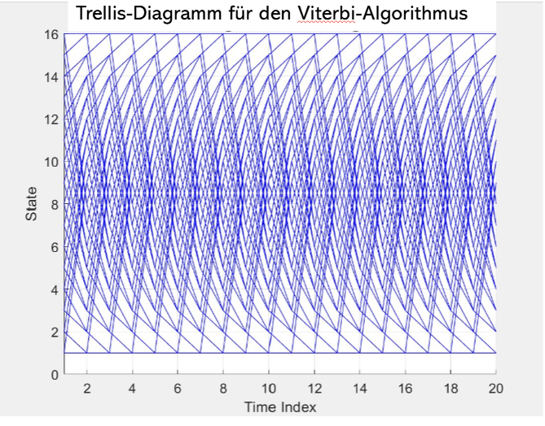
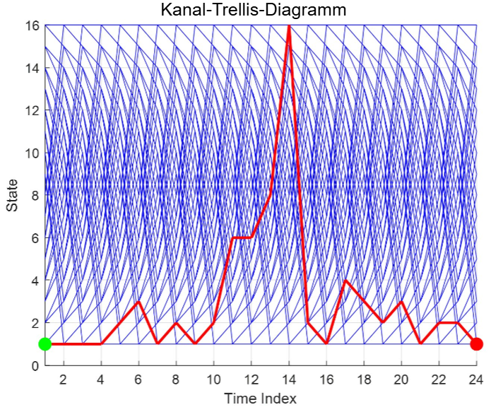
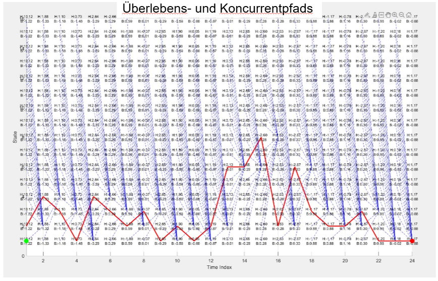
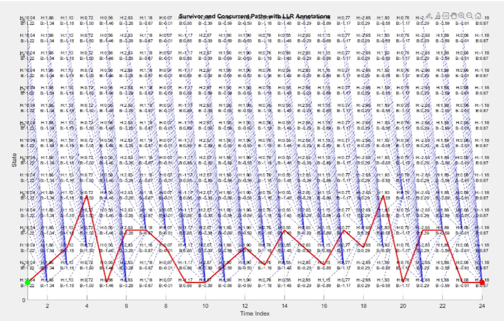
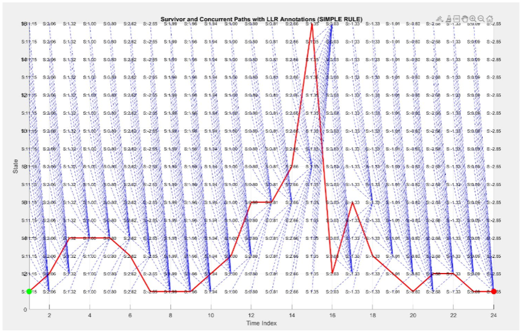
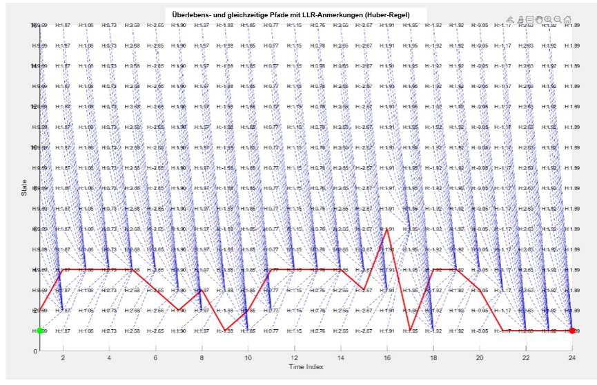
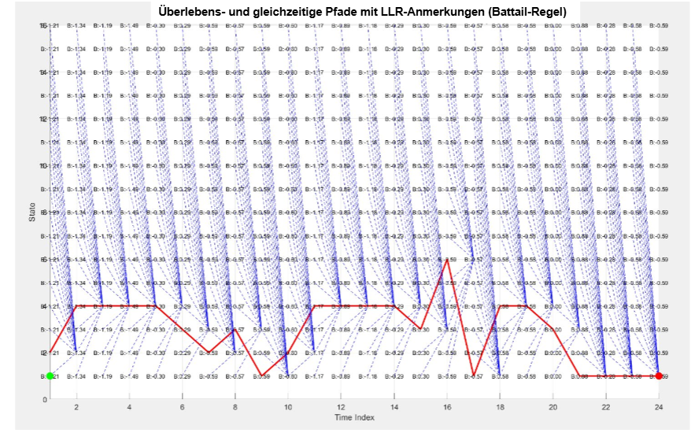
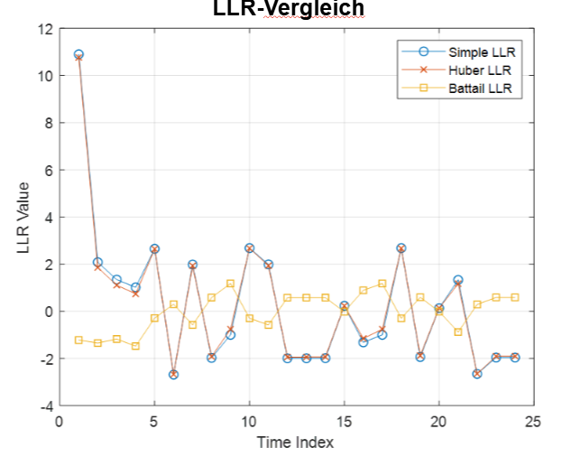
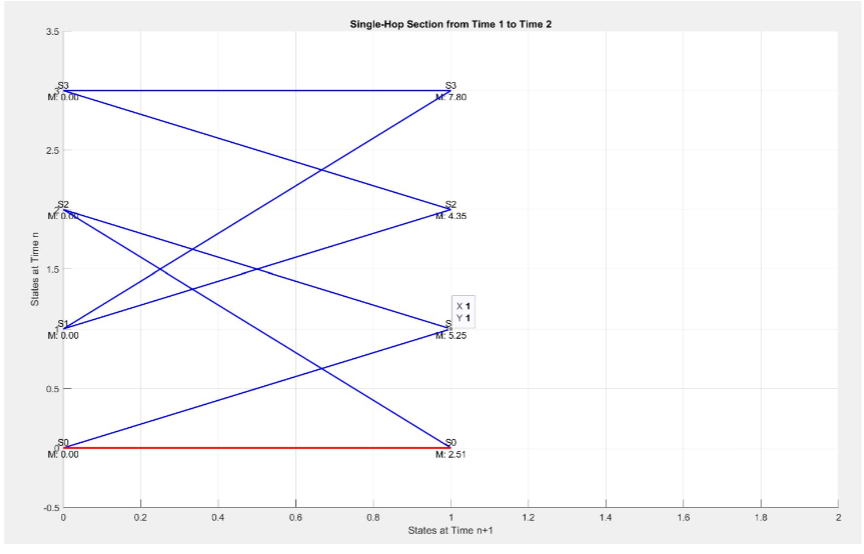

# Soft-Output-Viterbi-Algorithmus (SOVA) in MATLAB

> MATLAB-Implementierung des Soft-Output-Viterbi-Algorithmus (SOVA) zur Maximum-Likelihood-Sequenzdetektion (MLSD) in digitalen Kommunikationssystemen.

---

# Projekt auf einen Blick

| Kategorie | Beschreibung |
|------------|--------------|
| Programmiersprache | MATLAB |
| Fachgebiet | Digitale Nachrichtentechnik |
| Algorithmus | Soft-Output Viterbi Algorithm (SOVA) |
| Schwerpunkt | Maximum-Likelihood-Sequenzdetektion (MLSD) |
| Bewertungsgröße | Log-Likelihood Ratios (LLR) |
| Universität | Universität Duisburg-Essen |
| Projekttyp | Masterprojekt |
| Visualisierung | Trellis-Diagramme, Survivor Paths, Concurrent Paths |

---

# Projektübersicht

Dieses Repository dokumentiert die MATLAB-Implementierung des **Soft-Output-Viterbi-Algorithmus (SOVA)**, welche im Rahmen eines Masterprojekts an der **Universität Duisburg-Essen** entwickelt wurde.

Ziel des Projekts war die Simulation eines digitalen Übertragungssystems sowie die Implementierung eines leistungsfähigen Decodierungsverfahrens zur Maximum-Likelihood-Sequenzdetektion. Neben der eigentlichen Decodierung wurden verschiedene Verfahren zur Berechnung der **Log-Likelihood Ratios (LLR)** implementiert und miteinander verglichen.

Der Schwerpunkt liegt dabei auf der Visualisierung des vollständigen Decodierungsprozesses anhand von Trellis-Diagrammen, Survivor- und Concurrent-Pfaden sowie der Bewertung unterschiedlicher LLR-Aktualisierungsverfahren.

---

# Motivation

In digitalen Kommunikationssystemen werden Informationen häufig über gestörte Übertragungskanäle übertragen. Additives weißes Gaußsches Rauschen (AWGN) führt dabei zu Übertragungsfehlern und erschwert eine zuverlässige Bitdetektion.

Der klassische Viterbi-Algorithmus liefert ausschließlich die wahrscheinlichste Bitfolge. Für moderne Kanalcodierungsverfahren reichen harte Entscheidungen jedoch häufig nicht aus.

Der **Soft-Output-Viterbi-Algorithmus (SOVA)** erweitert den klassischen Algorithmus um Zuverlässigkeitsinformationen in Form von **Log-Likelihood Ratios (LLR)**. Dadurch können nachgelagerte Fehlerkorrekturverfahren deutlich bessere Ergebnisse erzielen.

---

# Projektziele

Im Rahmen dieses Projekts wurden folgende Ziele verfolgt:

- Implementierung des Soft-Output-Viterbi-Algorithmus in MATLAB
- Simulation eines digitalen Kommunikationskanals
- Maximum-Likelihood-Sequenzdetektion (MLSD)
- Berechnung von Branch- und Path-Metriken
- Implementierung verschiedener LLR-Verfahren
- Visualisierung der Zustandsübergänge mittels Trellis-Diagrammen
- Analyse von Survivor- und Concurrent-Pfaden
- Vergleich verschiedener LLR-Aktualisierungsregeln
- Bewertung des Decodierungsverhaltens unter verrauschten Kanalbedingungen

---

# Projektaufbau

Die Simulation bildet die vollständige digitale Übertragungskette nach.

```text
Binärdaten
      │
      ▼
Burst-Erzeugung
      │
      ▼
Kanalmodell
      │
      ▼
Additives Weißes Gaußsches Rauschen
      │
      ▼
Empfangenes Signal
      │
      ▼
Soft-Output Viterbi Decoder
      │
      ▼
LLR-Berechnung
      │
      ▼
Bitentscheidung
      │
      ▼
Auswertung
```

---

# Hauptfunktionen

Dieses Projekt umfasst unter anderem folgende Funktionen:

- MATLAB-Implementierung des Soft-Output-Viterbi-Algorithmus
- Simulation eines diskreten Übertragungskanals
- Maximum-Likelihood-Sequenzdetektion
- Trellis-basierte Kanalmodellierung
- Berechnung von Branch-Metriken
- Berechnung von Path-Metriken
- Survivor-Path-Bestimmung
- Concurrent-Path-Analyse
- LLR-Berechnung
- Vergleich unterschiedlicher LLR-Regeln
- Grafische Auswertung der Simulation
- Analyse der Decodierungsqualität

---

# Implementierte Verfahren

Im Rahmen des Projekts wurden mehrere Verfahren implementiert und miteinander verglichen.

## Maximum-Likelihood Sequence Detection (MLSD)

Die Decodierung basiert auf der Maximum-Likelihood-Sequenzdetektion. Hierbei wird die wahrscheinlichste Zustandsfolge anhand der kumulierten Pfadmetriken bestimmt.

---

## Forney-Metrik

Die Forney-Metrik bewertet jeden Zustandsübergang anhand der euklidischen Distanz zwischen empfangenem und erwartetem Signal.

Sie dient als Grundlage für die Berechnung der Branch-Metriken innerhalb des Trellis.

---

## Ungerboeck-Metrik

Neben der klassischen Forney-Metrik wurde ebenfalls die Ungerboeck-Metrik implementiert.

Diese stellt eine alternative Formulierung der Metrikberechnung dar und ermöglicht einen direkten Vergleich beider Ansätze.

---

# Verwendete LLR-Verfahren

Zur Berechnung der Zuverlässigkeitswerte wurden drei verschiedene Verfahren implementiert:

- Simple Rule
- Huber Rule
- Battail Rule

Anschließend wurden sämtliche Verfahren hinsichtlich ihres Einflusses auf die Bitzuverlässigkeit sowie die Stabilität der Decodierung untersucht.

---

## Trellis-Diagramm für den Viterbi-Algorithmus



Diese Abbildung zeigt das vollständige Trellis-Diagramm des Viterbi-Algorithmus. Alle möglichen Zustandsübergänge werden dargestellt und bilden die Grundlage für die Maximum-Likelihood-Sequenzdetektion.

---

## Kanal-Trellis-Diagramm



Das Kanal-Trellis-Diagramm visualisiert den Zustandsraum des simulierten Übertragungskanals. Der rot markierte Pfad entspricht der vom Decoder bestimmten wahrscheinlichsten Zustandsfolge.

---

## Überlebens- und Concurrentpfade



Diese Darstellung zeigt den Survivor Path sowie die konkurrierenden Pfade innerhalb des Trellis. Dadurch lässt sich nachvollziehen, welche alternativen Zustandsfolgen während der Decodierung berücksichtigt werden.

---

## Survivor and Concurrent Paths with LLR Annotations



Diese Abbildung zeigt die Survivor- und Concurrentpfade einschließlich der berechneten Log-Likelihood Ratios (LLR). Die dargestellten LLR-Werte veranschaulichen die Zuverlässigkeit der jeweiligen Bitentscheidungen.

---

## Survivor and Concurrent Paths with LLR Annotations (Simple Rule)



Darstellung der Survivor- und Concurrentpfade unter Verwendung der **Simple Rule** zur Berechnung der Log-Likelihood Ratios.

---

## Survivor and Concurrent Paths with LLR Annotations (Huber Rule)



Visualisierung der Survivor- und Concurrentpfade unter Anwendung der **Huber Rule**. Die berechneten LLR-Werte ermöglichen einen direkten Vergleich mit den anderen Verfahren.

---

## Survivor and Concurrent Paths with LLR Annotations (Battail Rule)



Darstellung der Survivor- und Concurrentpfade unter Verwendung der **Battail Rule**. Dieses Verfahren dient der Bewertung der Bitzuverlässigkeit anhand alternativer Pfade.

---

## LLR-Vergleich



Vergleich der berechneten Log-Likelihood Ratios für die implementierten Verfahren **Simple Rule**, **Huber Rule** und **Battail Rule**.

---

## Single-Hop Section



Diese Detailansicht zeigt einen einzelnen Übergang innerhalb des Trellis. Dargestellt werden die Branch-Metriken und Zustandsübergänge zwischen zwei aufeinanderfolgenden Zeitschritten.

---

# Projektstruktur

```text
wireless-communication-sova
│
├── matlab/
│   ├── main.m
│   ├── calculateLLR.m
│   ├── state2bits.m
│   ├── plot_single_hop_section.m
│   └── ...
│
├── bilder/
│   ├── trellis-diagramm.png
│   ├── kanal-trellis-diagramm.png
│   ├── ueberlebens-und-konkurrentpfade.png
│   ├── llr-vergleich.png
│   ├── ueberlebenspfad-simple-regel.png
│   ├── ueberlebenspfad-huber-regel.png
│   ├── ueberlebenspfad-battail-regel.png
│   └── single-hop-abschnitt.png
│
├── bericht/
│   ├── Abschlussbericht.pdf
│   └── Praesentation.pptx
│
├── README.md
├── LICENSE
└── .gitignore
```

---

# Projekt starten

## Voraussetzungen

- MATLAB R2022a oder neuer
- Signal Processing Toolbox (falls erforderlich)

## Ausführung

1. Repository klonen

```bash
git clone https://gitlab.com/USERNAME/wireless-communication-sova.git
```

2. MATLAB starten

3. Den Ordner `matlab` öffnen

4. Die Datei `main.m` ausführen

Nach Abschluss der Simulation werden automatisch sämtliche Diagramme und Auswertungen erzeugt.

---

# Verwendete Technologien

- MATLAB
- Digitale Nachrichtentechnik
- Soft-Output Viterbi Algorithm (SOVA)
- Maximum-Likelihood Sequence Detection (MLSD)
- Log-Likelihood Ratios (LLR)
- Trellis-Diagramme
- AWGN-Kanalmodell
- Forney-Metrik
- Ungerboeck-Metrik

---

# Literatur

Die Implementierung basiert auf den Inhalten des Masterprojekts sowie auf wissenschaftlicher Literatur zum Soft-Output-Viterbi-Algorithmus, zur Maximum-Likelihood-Sequenzdetektion und zur digitalen Nachrichtenübertragung.

Weitere Informationen sind im beigefügten Projektbericht enthalten.

---

# Autor

**Hamed Saber**

Masterstudent der Automatisierungstechnik

Universität Duisburg-Essen

---

## Lizenz

Dieses Projekt steht unter der **MIT-Lizenz**.

Weitere Informationen sind der Datei **LICENSE** zu entnehmen.

© Hamed Saber